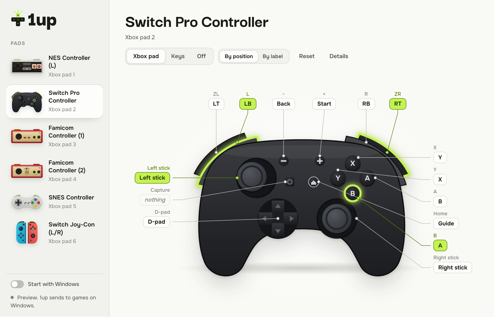
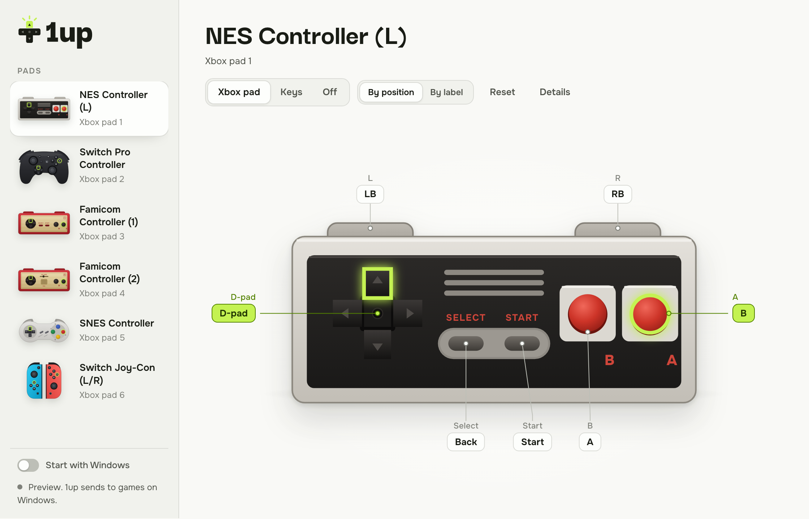
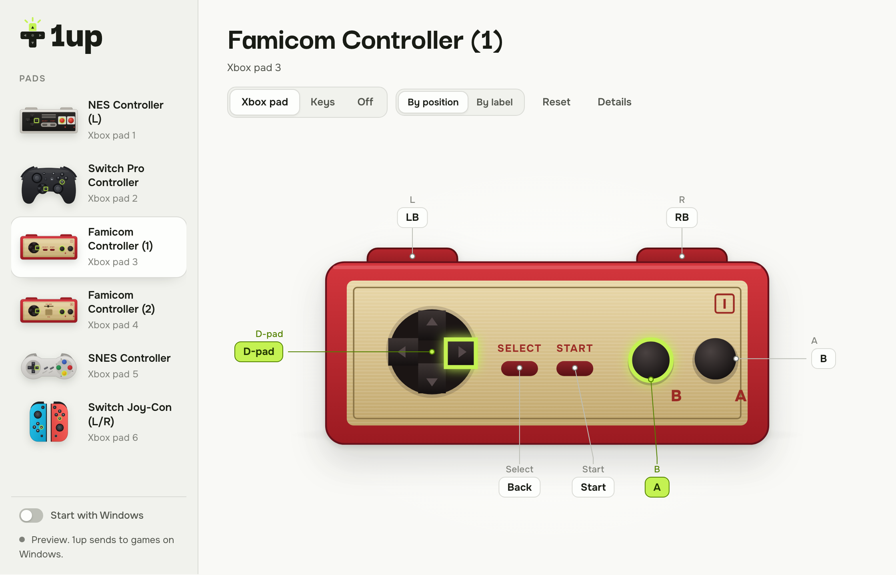
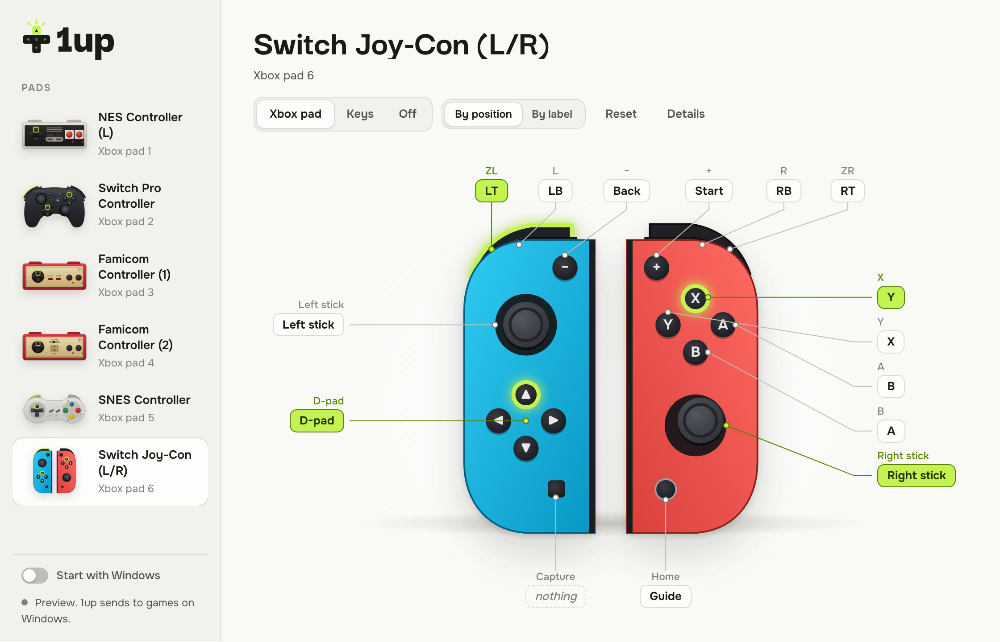
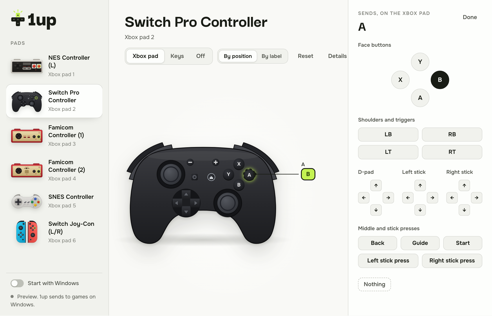

<p align="center">
  <picture>
    <source media="(prefers-color-scheme: dark)" srcset="design/logo-dark.svg">
    
  </picture>
</p>

<p align="center"><strong>a free rewasd for nintendo pads on windows</strong></p>

<p align="center">
  the switch online nes, famicom and snes pads, the switch pro controller and the joy-cons,<br>
  turned into a virtual xbox 360 pad or into keys, each button's mapping written on a picture of the pad.
</p>

<p align="center">
  <a href="https://github.com/loiclaudet/1up/releases/latest"><b>download for windows</b></a>
  &nbsp;·&nbsp; <a href="#use-it">use it</a>
  &nbsp;·&nbsp; <a href="#pads">pads</a>
  &nbsp;·&nbsp; <a href="#develop">develop</a>
</p>



## why

windows lists these pads, but most games and emulators can't read them: they speak nintendo's own protocol, not
xinput. the tool people pay for is rewasd. 1up does that part for free: it talks to each pad the way a switch does,
and hands games an xbox pad, or keys.

## what it does

- **every pad drawn as it is.** press a button and it lights on the picture, with what it sends written beside it.
- **an xbox 360 pad per nintendo pad**, or keyboard keys (no driver needed), or nothing.
- **face buttons by position or by label.** by position, nintendo's A is the xbox pad's B, where your thumb is:
  what games and emulators expect. by label, A stays A.
- **remap any button.** click it, then pick a target on the xbox pad, or press the key it should type.
- **set and forget.** one profile per pad, kept between runs. 1up lives in the tray and can start with windows.

<table>
  <tr>
    <td></td>
    <td></td>
  </tr>
  <tr>
    <td></td>
    <td></td>
  </tr>
</table>

## use it

1. install [vigembus](https://github.com/nefarius/ViGEmBus/releases/latest), the driver that makes the virtual xbox
   pads. keys work without it.
2. pair your pad in windows' bluetooth settings.
3. open 1up. the pad shows up, drawn as it is: press its buttons and watch them light.
4. click a button to change what it sends, or switch the whole pad to keys.
5. close the window: 1up keeps running in the tray. *start with windows* keeps it there from the start.

## pads

| pad | read | drawn |
| --- | :---: | :---: |
| switch online nes (l and r) | ✓ | ✓ |
| switch online famicom (1 and 2) | ✓ | ✓ |
| switch online snes | ✓ | ✓ |
| switch pro controller | ✓ | ✓ |
| joy-cons, paired | ✓ | ✓ |
| a joy-con alone | ✓ | schematic |
| switch online n64 and genesis | ✓ | schematic |

## known limits

- a game that also reads the nintendo pad itself (steam with its switch support on, an sdl based emulator) sees it
  twice: once as itself, once as 1up's xbox pad. turn one of them off there.
- a game running as administrator ignores the keys 1up types (windows keeps a normal app's keystrokes out of it):
  run 1up as administrator too, or use the xbox pad, which has no such limit.
- windows may warn about an unknown publisher: 1up isn't signed. *more info*, then *run anyway*.
- a pad misbehaving? *details* (top right) has a report to copy into an issue.

## develop

```bash
pnpm install
pnpm tauri dev                                    # the app, live reload (a mac shows the outputs as a preview)
pnpm dev                                          # the interface alone in a browser, on a demo with fake pads
pnpm test                                         # the page's tests (vitest)
cargo test --manifest-path src-tauri/Cargo.toml   # the rust side's
```

building from source needs cmake: SDL 3 is built in and linked statically. ci (`.github/workflows/ci.yml`) runs
both test suites on windows and on a mac, checks a virtual pad on a real vigembus, builds the windows app and starts
it once: the installer and a portable exe come out as an artifact. a `v*` tag turns them into a draft release.

how it is made: SDL reads the pads on its own thread with only its nintendo drivers on (`src-tauri/src/sdl.rs`),
the engine maps them (`engine.rs`, `mapping.rs`), vigembus and `SendInput` send them (`out.rs`, `keys.rs`), and the
page draws a view of it (`src/`). the logo is generated by `design/logo.py`; the design's reasons are in
`.impeccable.md`.

## credits

- [SDL](https://libsdl.org) (zlib) reads the pads.
- [vigem-client](https://github.com/CasualX/vigem-client) (mit) talks to [vigembus](https://github.com/nefarius/ViGEmBus)
  (bsd 3-clause, by nefarius).
- Darker Grotesque and Onest (sil open font licence).

1up is not affiliated with, endorsed or sponsored by Nintendo. Nintendo, Nintendo Switch, Joy-Con, Nintendo
Entertainment System, Super Nintendo Entertainment System and Family Computer are trademarks of Nintendo; they are
named here only to say which pads 1up works with. the pads are drawn by 1up and carry no logo.

## licence

mit, see [LICENSE](LICENSE).
