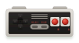
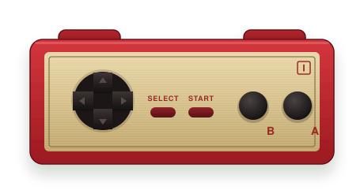
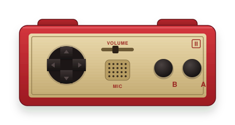
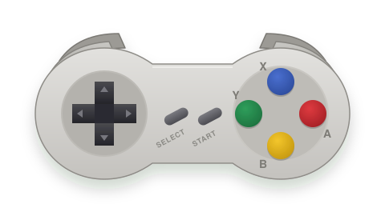
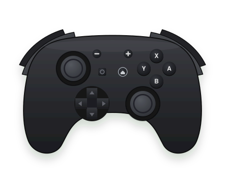
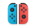
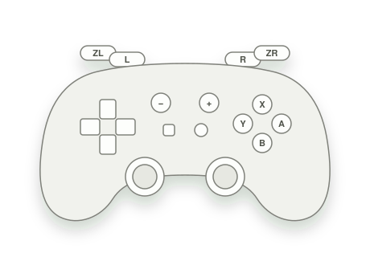

  <picture>
    <source media="(prefers-color-scheme: dark)" srcset="design/logo-dark.svg">
    
  </picture>

<h3 align="center">your nintendo pads, in every windows game</h3>

  the switch online nes, famicom and snes pads, the switch pro controller and the joy-cons: windows lists them, 
  but most games and emulators can't read them. 1up turns each one into an xbox pad, the pad every windows game knows. 
  1up is a free alternative to the popular <a href="https://www.rewasd.com/">rewasd</a>, made for nintendo pads, and open source.

  <a href="https://github.com/loiclaudet/1up/releases/latest/download/1up-setup.exe">
    <picture>
      <source media="(prefers-color-scheme: dark)" srcset="design/download-dark.svg">
      
    </picture>
  </a>

  windows 10 and 11, one installer · <a href="https://github.com/loiclaudet/1up/releases">every version</a>

  <a href="https://github.com/loiclaudet/1up/releases/latest/download/1up-setup.exe">
    <picture>
      <source media="(prefers-color-scheme: dark)" srcset="design/download-dark.svg">
      
    </picture>
  </a>

  <code>1up-setup.exe</code> installs 1up and the driver for its xbox pads, nothing else

## three steps

1. **install 1up.** [download `1up-setup.exe`](https://github.com/loiclaudet/1up/releases/latest/download/1up-setup.exe)
   and run it. it installs 1up, then the driver that lets it plug in xbox pads. windows asks you to allow the driver,
   and names its author: nefarius.
2. **pair your pad.** windows settings, *bluetooth & devices*, *add device*, *bluetooth*. hold the pad's sync button
   until its lights blink, then pick it in the list.
3. **play.** open 1up and press a button: your pad shows up, drawn as it is, lit where you press. your games and
   emulators now see an xbox pad.

a button should do something else? click it on the picture, then pick a button of the xbox pad, or switch the pad to
keys and press the key it should type. 1up keeps each pad's setup, and keeps running in the tray when you close it.

## is it safe?

- **it's open source.** every line of 1up is here, under the mit licence, and github builds the installer from it in
  the open: [the builds](https://github.com/loiclaudet/1up/actions/workflows/ci.yml).
- **it stays offline.** 1up never goes online. no account, no tracking, no ads.
- **the driver is vigembus**, by nefarius: open source too, and the one ds4windows and betterjoy use for their xbox
  pads. nefarius stopped working on it in 2023; its last version, the one 1up installs, runs on windows 10 and 11.
- **windows warns you the first time.** 1up is new and isn't signed (signing costs money every year), so your
  browser may say the file isn't commonly downloaded, and windows that it protected your pc. keep the file, then
  *more info*, *run anyway*.
- **it uninstalls cleanly.** windows settings, *apps*, 1up. the driver stays, other apps may need it: it has its
  own entry there, *ViGEm Bus Driver*.

## pads

each one works as an xbox pad or as keys.

| | pad |
| :---: | --- |
|  | switch online nes, left and right |
|  | switch online famicom 1 |
|  | switch online famicom 2 |
|  | switch online snes |
|  | switch pro controller |
|  | joy-cons, as a pair |
|  | a joy-con alone, the switch online n64 and genesis pads: drawn as a diagram for now |

<table>
  <tr>
    <td></td>
    <td></td>
  </tr>
  <tr>
    <td></td>
    <td></td>
  </tr>
</table>

## good to know

- **a game sees two pads?** some apps read nintendo pads themselves (steam with its switch support on, a few
  emulators), and see 1up's xbox pad too. turn one of them off there.
- **face buttons.** by default nintendo's A is the xbox pad's B: the button under your thumb, where games expect it.
  *by label* keeps A as A.
- **keys don't reach a game?** a game running as administrator ignores keys typed by other apps. run 1up as
  administrator too, or use the xbox pad, which has no such limit.
- **a pad misbehaves?** *details*, top right in 1up, has a report: paste it in
  [an issue](https://github.com/loiclaudet/1up/issues).
- **on a mac?** 1up is for windows.

## thanks

- [SDL](https://libsdl.org) reads the pads (zlib licence).
- [vigembus](https://github.com/nefarius/ViGEmBus), by nefarius, makes the xbox pads (bsd 3-clause licence, which
  ships with 1up), through [vigem-client](https://github.com/CasualX/vigem-client) (mit).
- Darker Grotesque and Onest, the fonts (sil open font licence).

want to build 1up or help? see [CONTRIBUTING.md](CONTRIBUTING.md).

1up is not affiliated with, endorsed or sponsored by Nintendo. Nintendo, Nintendo Switch, Joy-Con, Nintendo
Entertainment System, Super Nintendo Entertainment System and Family Computer are trademarks of Nintendo; they are
named here only to say which pads 1up works with. the pads are drawn by 1up and carry no logo. Xbox and Windows are
trademarks of Microsoft. reWASD is a trademark of its owner, and 1up is not affiliated with it.

## licence

mit, see [LICENSE](LICENSE).
